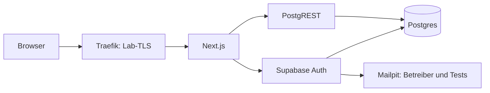
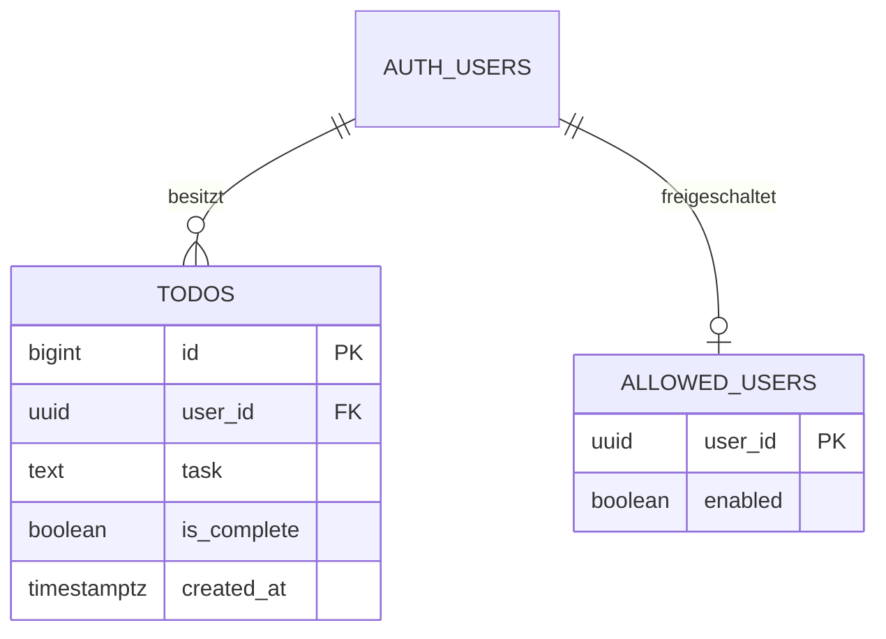

# Architektur: sd-test-todo-2
Kunde: Auftraggeber · Stand: 2026-11-09 · Klasse: S · Heikel: ja: personenbezogener Login
Status: Entwurf

## 1. Kurzfassung
Typ A: internes Lab-Werkzeug. Next.js/TypeScript mit selbst betriebenem Supabase; private Todos und Magic-Link-Login. Modularer Monolith: eine zustandslose App, Module auth/todos. Kein Code vor Merge des Design-PR.

## 2. Anforderungen (aus dem Interview)
Umfang am 2026-11-09 mit „ja, passt“ bestätigt.
| # | Frage | Antwort |
|---|---|---|
| 1 | Kern | Magic Link, eigene Todos anzeigen/anlegen/abhaken/löschen, abmelden, Daten nach Wiederanmeldung erhalten. |
| 2 | Nutzer/Rechte | Geschlossener Test, Betreiber legt bestätigte Konten an; keine freie Registrierung/Partner-API, eine Rolle; sofortiger Datenzugriffsverlust auch alter Sitzungen bei Sperre. |
| 3 | Last | Heute 10 Testnutzer, später <100 gleichzeitig, DACH, mehr Lesen; 20 Datenanfragen/s, p95 <500ms ohne Mailzustellung. |
| 4 | Daten | Mail/Auth, Todo-Text/Status/Erstellzeit; kein Name/sensible Inhalte, <10.000 Todos/Jahr; bis Löschung, Testdaten nach Projektende löschen. |
| 5 | Mandanten | Keine Firmen/Teams, Trennung je Nutzer. |
| 6 | Geräte | Deutsche mobile Web-App, kein Offline/native App. |
| 7 | Anbindungen | Supabase neu selbst betreiben; Mailfänger für echte Login-Mails, Tests lesen Link dort; kein externer Versand/Passwortlogin, Hinweis „keine Sitzung“ im Code erhalten. |
| 8 | Betrieb | Compose/GHCR/Pull, manuelle Promotion; Staging/prod getrennt, nur Lab. DOCKER_HOST=tcp://hermes-lab-dind:2375, Ports via hermes-lab-dind. |
| R2 | Sicherung/Alarme | Täglich, 7 Stände im eigenen Volume; 24h Datenverlust/4h Restore im Reaktionsfenster, Restore geübt; Serververlust-Risiko akzeptiert. Slack an Auftraggeber, werktags 09–18 Asia/Tokyo, 99,5% Ziel ohne Zusage. |
| R2 | Rahmen/Abnahme | Kein Termin/Zusatzkosten; zwei Konten komplett, Isolation auch direkte API, Backup/Restore belegt. Getrimmt ≥4 Zeichen, ID aufsteigend, Fehler sichtbar, Toggle umkehrbar/Löschen endgültig, kein Echtzeit-Sync. |

### Annahmen zur Designfreigabe
Schutzgrenzen 2.000 Zeichen/Todo, 100 Zeilen/Seite; Lab-TLS mit lokaler CA. Synthetische Konten bis Standort/Datenschutz geprüft. Nur vorhandene Ressourcen/Kontingente; bei Zusatzkosten stoppen. Kein ungeklärter Produktumfang.

## 3. Systemübersicht

Je Umgebung getrennte Netze/Volumes/Schlüssel/URLs. Nur Traefik veröffentlicht Lab-Ports; Mailfänger nur Betreiber/Tests, keine gemeinsame Inbox.
| Baustein | Grund aus Interview | Preis |
|---|---|---|
| Next.js App Router/TypeScript | 1/6: Formulare/Server Actions | Ein App-Image, eigener Betrieb |
| Auth/PostgREST/Postgres | 2/4/7: fertiger Login, Zeilenrechte | Auth-Schema/Updates pflegen |
| Mailpit | R2-1: interne Login-Mail | Inbox-Leser können Nutzer imitieren; keine echte Mailinhaberprüfung |
| Traefik | R2-3: Lab-Eingang/TLS | CA-Vertrauen verteilen |
| Watchtower-Fork, Backup-/Monitorjobs | 8/R2-4: Pull und Betrieb | Privilegierte Dienste isolieren |
Kein Storage/Realtime/Studio/Functions/n8n/Redis: kein V1-Bedarf. Minimale offizielle Supabase-Basis, keine eigene Auth.

## 4. Daten

Zwei eigene Tabellen; Provider-interne Auth-Schemas nicht als Fachmodelle gezählt. todos: bigint GENERATED ALWAYS AS IDENTITY (Ausnahme UUID-Standard für Vorlagensortierung), user_id NOT NULL DEFAULT auth.uid(), FK auth.users ON DELETE CASCADE; task DB-CHECK getrimmt 4..2000, is_complete NOT NULL DEFAULT false, created_at UTC/serverseitig. Index (user_id,id).
| Tabelle | Personenbezug | Leser/Schreiber | Konsistenz |
|---|---|---|---|
| public.todos | Text/Nutzer-ID | Aktiver Besitzer, vier RLS-Regeln | DB stark, nach Schreiben neu lesen; andere Fenster erst beim Neuladen |
| private.allowed_users | user_id/Freigabe | Nur Betreiber, Rechte-Helfer liest Status | Sperre ab Commit für neue Anfragen |
| auth.users/sessions | Mail/Identität/Sitzung | Nur Auth und enger Rechte-Helfer | Nicht exponiert |
RLS: Besitz UND private.can_access(); SELECT/DELETE USING, INSERT WITH CHECK, UPDATE beides. Helfer parameterlos, SECURITY DEFINER, leerer search_path, qualifizierte Namen, minimaler Besitzer, EXECUTE nur authenticated, PUBLIC/anon entziehen: enabled, banned_until und auth.sessions passend zu signiertem session_id/Nutzer prüfen. Bei Fehler verweigern. Private Tabelle ebenfalls RLS, keine Client-Grants. INSERT nur task, UPDATE nur is_complete; ID/Eigentümer/Zeit unveränderlich. Nur public exponieren, keine Nutzer-Schreib-RPC. Ausgabe id/task/is_complete/created_at, ID aufsteigend/100 pro Seite. Parallel: letzter Bool-Zielwert gewinnt; kein automatischer INSERT-Retry.

## 5. Abläufe
1. Betreiber legt bestätigtes Konto/Freigabe an. Auth-Signup aus, shouldCreateUser:false. Loginantwort neutral mit „keine Sitzung“. Mailpit empfängt Einmallink; fixer eigener /auth/confirm-Callback tauscht via verifyOtp gegen SSR-Cookies. Ablauf 30min; ungültig/wiederverwendet => sichtbarer Fehler, neuer Link. Keine Tokens in Logs/Referrer; no-store, danach saubere Ziel-URL.
2. Action prüft getUser(), Origin/CSRF, Zod; Nutzer-Token an REST, DB erzwingt Rechte/Invarianten auch ohne UI. Trimmen, Fehler sichtbar, nach Erfolg neu lesen. Logout beendet Sitzung und entfernt Cookies.
3. Sperren: enabled=false committen, danach Auth-Ban/Sitzungswiderruf. Altes JWT direkt an REST testen. Bereits gelesene Daten/vor Commit gestartete Transaktionen nicht rückrufbar; Wiederfreigabe bewusst durch Betreiber.

## 6. Skalierung: was bricht zuerst?
Ziel 20/s, p95 <500ms, <100 gleichzeitig; Lasttest vor Übergabe. Geprüfter Daemon: aarch64, 4 CPUs, 25.136.615.424 Byte RAM; freie Platte/konkurrierende Last vor Aufbau messen. Rechenannahme: 10×20=200 Aktionen/Tag, später 100×20=2.000=0,023/s durchschnittlich. 10.000×2KiB=19,53MiB/Jahr Rohtext ohne Indizes/Auth/Backups. Zehnfache Last: zuerst Abfragen/Pools/CPU, keine Microservices auf Vorrat.
| Stufe | Auslöser/Messung | Lösung/Preis | V1 |
|---|---|---|---|
| 0/1 | Bekannter Eigentümerfilter | Ein Server, Index user_id/id, Pagination; mehr Index-Schreibkosten | ja |
| 4 | Auth >2s/SMTP-Fehler | Interner Mailfänger, gedrosselter Retry/Fehler sichtbar; keine Eigenbau-Queue neben Auth | ja |
| 2/3 | CPU/RAM >70%/10min, Pool >80% | Abfragen/Limits/Pools optimieren, Ausbau nur neue Freigabe | später |
| 13 | >5 Logins/Konto/10min, >20/IP/min | Auth-/Proxy-Drossel, 429/Retry-After; kann Tests bremsen | ja |
| 10 | >20/s, p95 >500ms/10min nach Optimierung | Zweite zustandslose App, mehr Betrieb | später |
| 14 | Platte >80%, Backup >26h | Alarm/Retention; niemals DB automatisch löschen | ja |
N+1/select-*/unbegrenzte Listen vermeiden; kein personenbezogener Cache/Replica. Offene Verbesserung: externes Backup/Monitor für öffentlichen Betrieb.

## 7. Sicherheit
Geplant, noch nicht umgesetzt/getestet; Mindestziel OWASP ASVS L1.
| Kernpunkt ★ | Umsetzung |
|---|---|
| Fertiger Login | Supabase Auth, keine eigenen Passwörter, Signup serverseitig aus |
| Sitzung serverseitig | getUser statt getSession; SSR-Cookies Secure/SameSite, kein Local Storage; HttpOnly-Ausnahme mit CSP/Escaping ausgleichen |
| Rechte serverseitig | Alle geschützten Actions plus RLS/Freigabe |
| RLS überall | Regeln mit Tabelle migrieren; privat ohne Grants, Helfer siehe §4 |
| Fremde IDs | Besitz je CRUD, Negativtests echte Rollen, nicht service_role |
| Eingaben | Server-Zod, DB-CHECK/Spaltenrechte, Textgrenze |
| SQL/XSS | Parameter, React-Escaping, CSP, kein Todo-HTML/unsafe-eval |
| Geheimnisse | Getrennte Laufzeitdateien/gitignore/dockerignore, keine Defaults, Historie/Image scannen |
| Netz | Nur Lab-Traefik erreichbar, keine DB/Mail/Admin-Ports; Docker-TCP isolieren |
| SSH | Nicht genutzt, Daemon rootgleich, kein SSH-Push |
| HTTPS/HSTS | Lokale CA, Redirect/HSTS, keine Versionsheader |
| Abhängigkeiten | Geprüfte Pins/Lockfile, wöchentliche Updates |
| Logs | Keine Links/Querystrings/Tokens/Cookies/Mails/Todo-Texte, nur Referenz-ID |
| EU/Datenschutz | Standort/AVV nicht belegt: synthetische Konten bis Prüfung |
Weitere Kontrollen: Origin/CSRF, feste Redirect-Allowlist, no-store, Limits/Timeouts. Cascade-Kontolöschung, Logs 7 Tage, Mail 24h ohne Backup, Testdaten nach Ende löschen. Keine KI/Uploads/Webhooks/Partner-Keys/Zahlungen, Spezialkontrollen nicht relevant.
Routen: GET / (Login/privat), POST Actions (Login/Todos/Logout), GET /auth/confirm (erlaubter Token-Typ/fixe Zielroute), GET /health (Status/revision mit DB-Probe). Login/Callback/Health anonym; Daten nur mit Sitzung. Intern /auth/v1/* und /rest/v1/todos; Admin-Auth nur Betreiber; keine Debug-/Testpfade. Fehler: 400/422 Eingabe, 401 Sitzung, 403 Rechte/Origin, 404 unbekannt, 429 Limit, 503 Dienst; neutraler Loginstatus ausgenommen. Referenz-ID statt Stacktrace. Tests wie BAUPLAN; Ergebnisse erst nach Ausführung datieren.

## 8. Betrieb
Compose-Basis/Overrides, keine container_name; Healthchecks/restart unless-stopped, getrennte Volumes. Basis Supabase self-hosted/v0.8.4 verifiziert; ARM-Manifeste/Digests vor Aufbau prüfen. Registry am 2026-11-09: Next 16.4.5, supabase-js 2.119.0, SSR 0.12.7. Node 24 Alpine Patch/Digest im Gerüst prüfen. Non-root-Standalone-Multi-Stage ohne npm/corepack/Build-Secrets; Runtime-Konfiguration, kein NEXT_PUBLIC-Umgebungsbuild.
Pipeline/Details in BAUPLAN: check → image → publish nach Mensch-Merge → Lab-E2E-Nachweis → Mensch-Promote. Mensch installiert Skillvorlagen mit ARM/Magic-Link/Lab-Anpassungen; minimale Rechte, Actions-SHA-Pins, kein self-hosted Runner. Lab-Nachweise unabhängig vor Promote prüfen.
Feste sha-/bewegliche staging/prod-Tags, gleicher Digest; nickfedor/watchtower --label-enable nur App. GHCR serverseitig nur lesen. Separate Migration vor Appstart mit Transaktion/Lock, Fehler ungesund, App ohne DDL. Expand/contract, Backup davor, DB-Rollback nicht durch Image; 3–5 Stände behalten, Rollback üben.
Privates persönliches Repo, Plan unbekannt: Free-Notregel ohne bezahlte Schutzversprechen. 0 Zusatzkosten, bei Kontingentende stoppen. Backup täglich 02:00 Asia/Tokyo, 7 Stände/Umgebung: Dump inkl. Auth/Rollen/Freigaben, Konfiguration verschlüsselt, Schlüssel getrennt. Restore bleibt offline: alle Freigaben aus/Sitzungen widerrufen; separates Betreiber-Sperr-/Löschjournal anwenden, sonst geschlossen bleiben. Details/Test/Einbahnstraßen in BAUPLAN. 24h Datenverlust/4h Restore bei verfügbarem Host/Backup, Hostverlust nicht garantiert.
Betreiberpräzisierung: V1 überwacht nur Kartenstillstand per Stillstand-Job/Slack, nicht App/Backup/Platte/Hostausfall. Logs 7 Tage, Reaktion werktags 09–18 Asia/Tokyo, 99,5% Ziel ohne SLA. Host/Traefik/DB bleiben Ausfallpunkte. Lab-Abweichungen: Backup nur Volume, Mailpit, lokale CA, projektbezogenes setup.sh; kein unabhängiger Ausfallmonitor zugesagt.
Einrichtung und Webhooks laut Betreiber fertig. Freigabe erst durch menschlichen Merge des Design-PR. Lab-Nachweise bleiben im Lab, unabhängig an Commit/Digest prüfen.

## 9. Bauplan
BAUPLAN.md: fünf Schritte, CI plus unabhängiger Prüfer je Schritt; Mensch merged/promotet. Noch keine Anwendungstests ausgeführt.

## 10. Nicht in Version 1
Externer SMTP-Versand, öffentliche Nutzung, Teams, Offline, Echtzeit, Zahlung, KI, Admin-UI.

## 11. Über der Klasse
Keine Erweiterung: zwei eigene Tabellen, eine Rolle, fünf Schritte. Zwei Umgebungen/Mailfänger vom Auftrag gefordert. Größeres Startgerüst gegenüber PR-Richtwert im PR begründen.

## 12. Entscheidungen
001-daten-auth.md, 002-lab-betrieb.md in entscheidungen/, vorgeschlagen bis Merge des Design-PR. Vorlage: /opt/data/workspace/labjobs/vorlage.md, Original-Commit 8b01d388b91ef06d0149c7cfe4a2a46618eb7fd6, Apache-2.0 laut Vorlage, kein Code kopiert. F1–F3 durch Magic Link ersetzt, F4–F9 erhalten.
Quellen geprüft 2026-11-09: https://supabase.com/docs/guides/auth/auth-email-passwordless ; https://supabase.com/docs/guides/auth/sessions ; https://supabase.com/docs/guides/self-hosting/docker ; https://supabase.com/docs/guides/auth/server-side/nextjs ; https://docs.github.com/en/get-started/learning-about-github/githubs-plans .

## 13. Glossar
| Begriff | Bedeutung mit Beispiel |
|---|---|
| RLS | DB-Recht je Zeile: A liest B nicht. |
| JWT | Signiertes Anmeldetoken: Live-Sperre zusätzlich prüfen. |
| PostgREST | Automatische Daten-API: /rest/v1/todos. |
| Migration | Versionierter DB-Umbau: Tabelle/Rechte gemeinsam. |
| Digest/Promotion | Fester Image-Inhalt/unverändertes Weiterreichen: Staging wird prod. |
| CI/Gate | Automatische Prüfung/Prüftor: make check rot stoppt. |
| p95 | 95% der Werte darunter: hier 500ms. |
| RPO/RTO | Datenverlust-/Restore-Ziel: 24h/4h. |
| CSP/CSRF | Skriptregel/Fremdaktionsschutz: kein Fremdskript, Origin-Prüfung. |
| ADR | Entscheidungsdatei mit Preis: 001-daten-auth.md. |
| Mailfänger | Interne Inbox: Mailpit statt externer Zustellung. |
